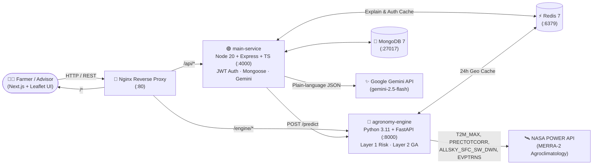

# TerraShift
# 🌍 TerraShift — Field Shift: Adapting Farms with NASA Data

**2026 NASA Space Apps Challenge**

TerraShift is a decision-support platform that helps smallholder farmers adapt to shifting climate and market conditions. By combining **NASA POWER Agroclimatology** satellite reanalysis data with a two-layer agronomic intelligence engine (**Seasonal-Trend Time-Series Regression + AR(1)** for environmental risk and a **Multi-Objective Genetic Algorithm** for 3-season crop rotation optimization) and **Google Gemini** plain-language explainability, TerraShift recommends resilient, profitable crop rotations tailored to each field's geofence, soil type, and farmer priority.

---

## 🏗️ System Architecture



---

## 📁 Monorepo Structure & Team Ownership

To allow all **6 team members** to build in parallel without merge conflicts, each member owns an isolated directory or module boundary. Cross-service payload changes must be coordinated via [`docs/api-contract.md`](docs/api-contract.md).

```text
TerraShift/
├── .github/
│   ├── ISSUE_TEMPLATE/task.md        # Hackathon task issue template
│   └── CODEOWNERS                    # Module-level PR review ownership
├── docs/
│   └── api-contract.md               # Single source of truth for JSON schemas
├── frontend/                         # Next.js 15 (App Router) + TS + Tailwind + React-Leaflet
│   ├── app/                          # Routes: /, /login, /farm, /results/[id]
│   ├── components/                   # FarmMap, RiskPanel, StrategyCard, Navbar
│   ├── lib/                          # Typed API client, auth helpers, offline mock data
│   └── vercel.json                   # Vercel deployment config
├── main-service/                     # Node.js 20 + Express + TypeScript REST API (:4000)
│   └── src/
│       ├── config/                   # Zod-validated environment config
│       ├── db/                       # Mongoose (MongoDB) & ioredis connectors
│       ├── middleware/               # JWT auth + Redis token revocation, Zod validation, errors
│       ├── models/                   # User, Farm (2dsphere GeoJSON), Analysis
│       ├── routes/                   # /api/auth, /api/farms, /api/analyses, /api/crops, /api/health
│       └── services/                 # agronomyClient.ts & gemini.ts explainability wrapper
├── agronomy-engine/                  # Python 3.11 + FastAPI (:8000)
│   ├── app/
│   │   ├── main.py                   # FastAPI endpoints (/predict, /crops, /health)
│   │   ├── nasa_client.py            # NASA POWER monthly client + 24h Redis cache + fallback
│   │   ├── layer1_risk.py            # Layer 1: OLS Seasonal-Trend + AR(1) risk engine
│   │   └── layer2_rot.py             # Layer 2: Genetic Algorithm 3-season rotation optimizer
│   ├── data/crop_lookup.json         # 12 regional crops with water, N, root, & market parameters
│   └── tests/                        # Pytest unit & offline integration suite
├── nginx/
│   └── nginx.conf                    # Reverse proxy (:80 -> main-service, agronomy-engine, frontend)
├── docker-compose.yml                # Full local orchestration
└── .env.example                      # Master environment variable template
```

### 👥 6-Member Ownership Split

| Member | Role | Owned Paths |
| :--- | :--- | :--- |
| **1. Lead / DevOps** | Architecture, Docker, Nginx, Contracts | `docker-compose.yml`, `nginx/`, `docs/`, `.github/`, `README.md` |
| **2. Data / NASA Engineer** | NASA POWER ingestion & Redis caching | `agronomy-engine/app/nasa_client.py`, `agronomy-engine/app/cache.py` |
| **3. Risk Modeller (Layer 1)** | Time-series regression & vulnerability scores | `agronomy-engine/app/layer1_risk.py` |
| **4. Rotation Optimizer (Layer 2)** | Genetic algorithm & crop agronomy table | `agronomy-engine/app/layer2_rot.py`, `agronomy-engine/data/crop_lookup.json` |
| **5. Backend & LLM Engineer** | Auth, Express API, MongoDB, Gemini wrapper | `main-service/` |
| **6. Frontend Engineer** | Next.js UI, Leaflet polygon drawing, Dashboard | `frontend/` |

---

## 🧠 Core Scientific & AI Modules

### 1. NASA POWER Agroclimatology Client (`agronomy-engine/app/nasa_client.py`)
- Queries `https://power.larc.nasa.gov/api/temporal/monthly/point` (`community=AG`) for the farm's geofence centroid `(lat, lon)`.
- Parameters fetched:
  - `T2M_MAX` — Maximum daily air temperature at 2 m (°C)
  - `PRECTOTCORR` — Bias-corrected precipitation rate (mm/day → mm/month)
  - `ALLSKY_SFC_SW_DWN` — All-sky surface shortwave downward irradiance (kWh/m²/day)
  - `EVPTRNS` — Evapotranspiration energy flux (MJ/m²/day → converted via latent heat of vaporization $\lambda = 2.45\text{ MJ/kg}$ to mm/month)
- **Smart Geo-Caching:** Coordinates are rounded to **2 decimal places** (~1.1 km grid) and cached in Redis (`redis://redis-cache:6379`) with a **24-hour TTL** so neighboring farms share cached satellite queries.
- **Deterministic Offline Fallback:** If NASA POWER times out or is unreachable during a live demo, a bimodal monsoon synthetic generator seeded by `(lat, lon)` returns reproducible monthly series (`source: "fallback"`).

### 2. Layer 1: Environmental & Regional Vulnerability Engine (`agronomy-engine/app/layer1_risk.py`)
Fits an **Ordinary Least Squares (OLS) Seasonal-Trend Regression with AR(1) residual dynamics** to each historical series:

$$y_t = \beta_0 + \beta_1 t + \sum_{m=2}^{12} \gamma_m D_m(t) + \varepsilon_t, \qquad \varepsilon_t = \phi \varepsilon_{t-1} + \eta_t$$

- **Soil Moisture Deficit Trend:** Forecasts 12–30 months of water balance ($\text{Precip} - \text{ET}$), computing cumulative deficit (mm), confidence intervals, and long-term drying slope ($\text{mm/yr}$).
- **Bare-Field Erosion Windows:** Cross-references forecast high-rainfall months with the crop's growth duration and soil erodibility factor ($K_{\text{soil}}$) to flag `low | medium | high` erosion windows.
- **Heat Stress Risk:** Forecasts `T2M_MAX` against each crop's specific heat tolerance threshold (°C).
- **Regional Saturation Simulator:** Uses a coordinate-seeded Dirichlet spatial survey to estimate neighbor crop shares, Herfindahl-Hirschman Index (HHI), **market oversupply risk** (>30% same crop), and **monoculture pest vulnerability** (>50% same botanical family).

### 3. Layer 2: Evolutionary Multi-Season Rotation Optimizer (`agronomy-engine/app/layer2_rot.py`)
Uses a **Genetic Algorithm (GA)** (tournament selection, one-point crossover, per-gene mutation, elitism, and memoized fitness evaluation) across 12 regional crops (`Paddy Rice`, `Mung Bean`, `Cowpea`, `Maize`, `Finger Millet`, `Groundnut`, `Sesame`, `Chilli`, `Big Onion`, `Sunn Hemp`, `Chickpea`, `Cassava`) to evolve 3 distinct 3-season (Maha / Yala / Maha) strategies:
- **Strategy A — Baseline:** Continues the farmer's current crop for 3 seasons, demonstrating compounding nitrogen depletion, declining soil organic matter (SOM), pest build-up, and +8%/season fertilizer inflation.
- **Strategy B — Soil & Water Resilience:** Maximizes biological nitrogen fixation (legumes & cover crops), SOM recovery, root depth diversity, and drought tolerance.
- **Strategy C — Cost & Market Optimized:** Maximizes 3-season net margin ($/ha) by crediting residual biological nitrogen to subsequent heavy feeders and penalizing regionally oversupplied crops.

### 4. Gemini Explainability Wrapper (`main-service/src/services/gemini.ts`)
- Summarizes the numerical risk & strategy output into farmer-friendly JSON (`summary`, `per_strategy` headlines/reasons/risks/first steps, and `caveats`) using `gemini-2.5-flash`.
- Caches responses in Redis by SHA-256 content digest and automatically falls back to a deterministic template if `GEMINI_API_KEY` is not configured.

---

## 🚀 Quick Start

### Option A: Run Everything with Docker Compose (Recommended)

1. **Configure environment variables:**
   ```bash
   cp .env.example .env
   # Optional: add your GEMINI_API_KEY in .env
   ```

2. **Start the backend stack (Nginx + Main Service + Agronomy Engine + MongoDB + Redis):**
   ```bash
   docker compose up --build -d
   ```
   *(To also run the Next.js container inside Docker instead of locally, run `docker compose --profile full up --build -d`.)*

3. **Verify service health:**
   ```bash
   curl http://localhost/nginx-health
   curl http://localhost/api/health
   curl http://localhost/engine/health
   ```

### Option B: Local Development (Per Module)

Run MongoDB and Redis via Docker (`docker compose up -d mongo redis-cache`), then start only the service you are working on:

#### 1. `agronomy-engine` (Port 8000)
```bash
cd agronomy-engine
cp .env.example .env
python3 -m venv .venv
source .venv/bin/activate
pip install -r requirements.txt
uvicorn app.main:app --reload --port 8000
# Run unit & offline integration tests:
pytest
```
Interactive Swagger UI is available at `http://localhost:8000/docs`.

#### 2. `main-service` (Port 4000)
```bash
cd main-service
cp .env.example .env
npm install
npm run dev
# Type-check:
npm run typecheck
```

#### 3. `frontend` (Port 3000)
```bash
cd frontend
cp .env.example .env.local
npm install
npm run dev
```
Open `http://localhost:3000` in your browser.

---

## 🔌 API Reference Overview

Full request/response schemas are documented in [`docs/api-contract.md`](docs/api-contract.md).

### `main-service` (`/api/*`)

| Method | Endpoint | Auth | Description |
| :--- | :--- | :--- | :--- |
| `GET` | `/api/health` | Public | Readiness check across MongoDB, Redis, and `agronomy-engine` |
| `GET` | `/api/crops` | Public | List all 12 regional crops from `crop_lookup.json` |
| `POST` | `/api/auth/register` | Public | Register a farmer/advisor account & receive a Bearer JWT |
| `POST` | `/api/auth/login` | Public | Authenticate & receive a Bearer JWT |
| `GET` | `/api/auth/me` | Bearer JWT | Get current authenticated user profile |
| `POST` | `/api/auth/logout` | Bearer JWT | Revoke current JWT in Redis blocklist |
| `GET` | `/api/farms` | Bearer JWT | List saved farm geofences for current user |
| `POST` | `/api/farms` | Bearer JWT | Save a new farm GeoJSON polygon, soil type, and crop |
| `POST` | `/api/analyses` | Bearer JWT | Run full NASA + Layer 1 + Layer 2 + Gemini analysis (by `farm_id` or ad-hoc polygon) |
| `GET` | `/api/analyses/:id` | Bearer JWT | Fetch saved analysis prediction + Gemini explanation |

### `agronomy-engine` (`:8000` or `/engine/*`)

| Method | Endpoint | Description |
| :--- | :--- | :--- |
| `GET` | `/health` | Engine & Redis health status |
| `GET` | `/crops` | Raw 12-crop agronomic lookup table |
| `POST` | `/predict` | Run NASA POWER fetch + Layer 1 regression + Layer 2 GA optimizer |

#### Example `POST /predict` Request
```bash
curl -X POST http://localhost:8000/predict \
  -H "Content-Type: application/json" \
  -d '{
    "polygon": {
      "type": "Polygon",
      "coordinates": [[[80.63, 7.29], [80.64, 7.29], [80.64, 7.30], [80.63, 7.30], [80.63, 7.29]]]
    },
    "centroid": { "lat": 7.295, "lon": 80.635 },
    "current_crop": "paddy_rice",
    "soil_type": "clay",
    "priority": "water"
  }'
```

---

## ☁️ Deployment (Vercel + Docker Host)

1. **Frontend (Vercel):**
   - Import the repository into Vercel and set the **Root Directory** to `frontend`.
   - Set environment variable `NEXT_PUBLIC_API_BASE_URL` to your deployed backend gateway URL (e.g. `https://api.terrashift.example.com/api`).
2. **Backend Stack (Any Docker Host / VM):**
   - Copy `.env.example` to `.env`, set a strong `JWT_SECRET`, add `GEMINI_API_KEY`, and include your Vercel domain in `CORS_ORIGINS`.
   - Run `docker compose up --build -d`.

---

## 🤝 Git Workflow for the Hackathon

1. Pick or open an issue using the [Hackathon Task template](.github/ISSUE_TEMPLATE/task.md).
2. Branch off `main` using `<module>/<short-name>` (e.g., `feat/layer1-drought-index` or `feat/frontend-map-draw`).
3. Keep changes inside your assigned module directory.
4. Run local checks (`pytest` or `npm run typecheck`) before opening a Pull Request.