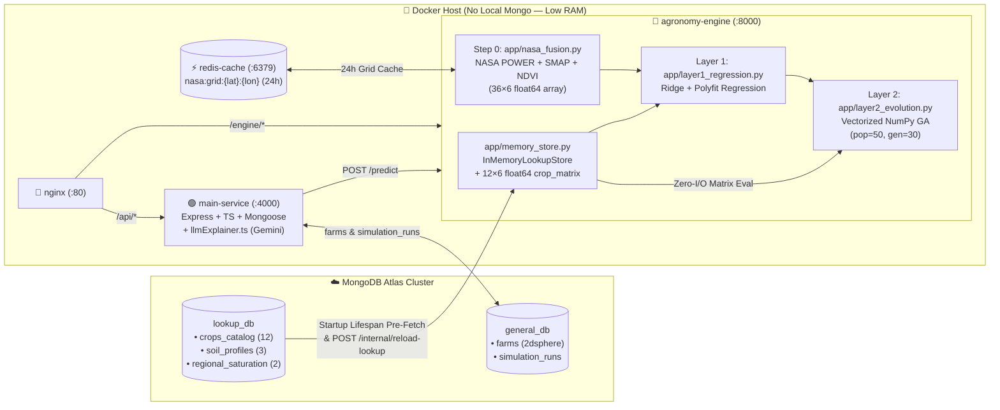

# 🌍 TerraShift — Field Shift: Adapting Farms with NASA Data

**2026 NASA Space Apps Challenge**

TerraShift is an agronomy decision-support platform that helps farmers adapt to climate and market shifts using **NASA POWER Agroclimatology**, **SMAP Root-Zone Soil Moisture**, and **MODIS/Sentinel-2 NDVI** data. It uses a **MongoDB Atlas Dual-Database Architecture (`lookup_db` + `general_db`)** paired with an **In-Memory NumPy/Redis Processing Pipeline** that executes 36-month spatial-temporal regression and a multi-objective Genetic Algorithm in **under 15 ms** in RAM.

---

## 🏗️ System & Database Architecture



---

## 🧠 2-Layer In-Memory Agronomy Engine (`agronomy-engine/`)

1. **`seed_atlas.py` (Dual-Database Seeder)**
   - Seeds `lookup_db.crops_catalog` (12 crops backed by FAO GAEZ & USDA AMS Market News: `paddy_rice`, `mung_bean`, `cowpea`, `maize`, `finger_millet`, `groundnut`, `sesame`, `chilli`, `onion`, `sunn_hemp`, `chickpea`, `cassava`), `lookup_db.soil_profiles` (`soil_sandy_loam`, `soil_clay_loam`, `soil_degraded_dry`), and `lookup_db.regional_saturation` (`region_lk_dryzone`, `region_us_midwest`).
   - Seeds `general_db.farms` with `farm_demo_01` (`2dsphere` index on `polygon`) and creates a `(farm_id, created_at)` index on `general_db.simulation_runs`.
2. **`app/memory_store.py` (`InMemoryLookupStore`)**
   - Pre-fetches `lookup_db` on FastAPI startup (`lifespan`) and packs a contiguous 2D `np.float64` matrix `self.crop_matrix` (`shape = 12 × 6`: `[water_demand_mm, drought_tolerance, nitrogen_impact_kg_ha, erosion_cover_factor, input_cost_usd_ha, market_revenue_usd_ha]`).
   - Includes a deterministic local seed fallback so the container boots even if `ATLAS_MONGO_URI` is not yet set, and exposes `POST /internal/reload-lookup`.
3. **`app/nasa_fusion.py` (Step 0: Spatial-Temporal Data Fusion + Redis Cache)**
   - Fetches monthly NASA POWER (`T2M_MAX`, `PRECTOTCORR`, `ALLSKY_SFC_SW_DWN`, `EVPTRNS`), cached at `nasa:grid:{lat:.2f}:{lon:.2f}` for 24h in Redis, and harmonizes with SMAP root-zone soil moisture and MODIS/Sentinel-2 NDVI into a `36 × 6` NumPy array.
4. **`app/layer1_regression.py` (Layer 1: In-Memory Regression Engine)**
   - Uses `scikit-learn` `Ridge` and `numpy.polyfit` to project the next 3 seasons' available water budget (`season_water_budgets_mm`), October root-zone soil moisture anomaly (%), bare-field erosion risk, and regional neighbor-farm oversupply penalties.
5. **`app/layer2_evolution.py` (Layer 2: Vectorized Multi-Objective Genetic Algorithm)**
   - Evaluates `[season1_crop_idx, season2_crop_idx, season3_crop_idx]` chromosomes (`pop_size=50`, `n_gen=30`) in pure NumPy across Soil Health ($F_{\text{soil}}$), Water Resilience ($F_{\text{water}}$), and Farm Economics ($F_{\text{cost}}$) to produce:
     - `A_BASELINE` (current practice)
     - `B_SOIL_WATER_RESILIENCE`
     - `C_COST_MARKET_OPTIMIZED`

---

## 🚀 Quick Start

```bash
# 1. Configure environment variables
cp .env.example .env
# Add ATLAS_MONGO_URI (and optional GEMINI_API_KEY) to .env

# 2. (Optional) Seed MongoDB Atlas lookup_db + general_db
cd agronomy-engine && python seed_atlas.py && cd ..

# 3. Start Redis, Agronomy Engine, Main Service, and Nginx Gateway
docker compose up --build -d

# 4. Run a full simulation via main-service
curl -X POST http://localhost/api/analyze \
  -H "Content-Type: application/json" \
  -d '{"farm_id": "farm_demo_01", "priority": "water"}'
```
