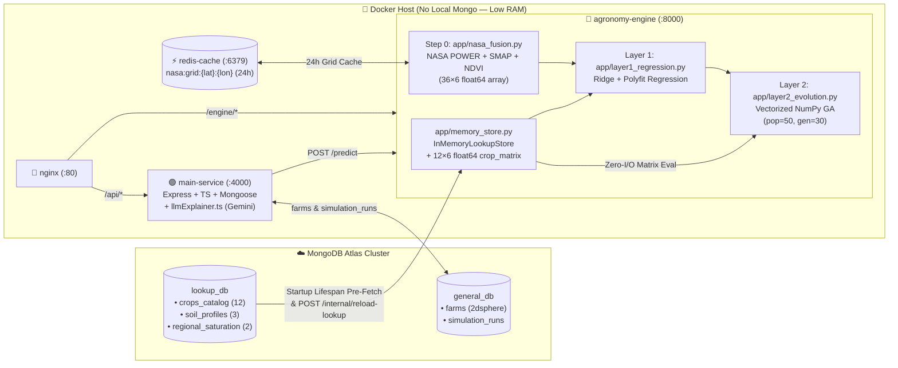

# 🌍 TerraShift — Field Shift: Adapting Farms with NASA Data

**2026 NASA Space Apps Challenge**

TerraShift is an agronomy decision-support platform that helps farmers adapt to climate and market shifts using **NASA POWER Agroclimatology**, **SMAP Root-Zone Soil Moisture**, and **MODIS/Sentinel-2 NDVI** data. It uses a **MongoDB Atlas Dual-Database Architecture (`lookup_db` + `general_db`)** paired with an **In-Memory NumPy/Redis Processing Pipeline** that executes 36-month spatial-temporal regression and a multi-objective Genetic Algorithm in **under 15 ms** in RAM.

---

## 🏗️ System & Database Architecture



---

## 🧠 2-Layer In-Memory Agronomy Engine (`agronomy-engine/`)

1. **`seed_atlas.py` (Dual-Database Seeder)**
   - Seeds `lookup_db.crops_catalog` (12 crops backed by FAO GAEZ & USDA AMS Market News: `paddy_rice`, `mung_bean`, `cowpea`, `maize`, `finger_millet`, `groundnut`, `sesame`, `chilli`, `onion`, `sunn_hemp`, `chickpea`, `cassava`), `lookup_db.soil_profiles` (`soil_sandy_loam`, `soil_clay_loam`, `soil_degraded_dry`), and `lookup_db.regional_saturation` (`region_lk_dryzone`, `region_us_midwest`).
   - Seeds `general_db.farms` with `farm_demo_01` (`2dsphere` index on `polygon`) and creates a `(farm_id, created_at)` index on `general_db.simulation_runs`.
2. **`app/memory_store.py` (`InMemoryLookupStore`)**
   - Pre-fetches `lookup_db` on FastAPI startup (`lifespan`) and packs a contiguous 2D `np.float64` matrix `self.crop_matrix` (`shape = 12 × 6`: `[water_demand_mm, drought_tolerance, nitrogen_impact_kg_ha, erosion_cover_factor, input_cost_usd_ha, market_revenue_usd_ha]`).
   - Includes a deterministic local seed fallback so the container boots even if `ATLAS_MONGO_URI` is not yet set, and exposes `POST /internal/reload-lookup`.
3. **`app/nasa_fusion.py` (Step 0: Spatial-Temporal Data Fusion + Redis Cache)**
   - Fetches monthly NASA POWER (`T2M_MAX`, `PRECTOTCORR`, `ALLSKY_SFC_SW_DWN`, `EVPTRNS`), cached at `nasa:grid:{lat:.2f}:{lon:.2f}` for 24h in Redis, and harmonizes with SMAP root-zone soil moisture and MODIS/Sentinel-2 NDVI into a `36 × 6` NumPy array.
4. **`app/layer1_regression.py` (Layer 1: In-Memory Regression Engine)**
   - Uses `scikit-learn` `Ridge` and `numpy.polyfit` to project the next 3 seasons' available water budget (`season_water_budgets_mm`), October root-zone soil moisture anomaly (%), bare-field erosion risk, and regional neighbor-farm oversupply penalties.
5. **`app/layer2_evolution.py` (Layer 2: Vectorized Multi-Objective Genetic Algorithm)**
   - Evaluates `[season1_crop_idx, season2_crop_idx, season3_crop_idx]` chromosomes (`pop_size=50`, `n_gen=30`) in pure NumPy across Soil Health ($F_{\text{soil}}$), Water Resilience ($F_{\text{water}}$), and Farm Economics ($F_{\text{cost}}$) to produce:
     - `A_BASELINE` (current practice)
     - `B_SOIL_WATER_RESILIENCE`
     - `C_COST_MARKET_OPTIMIZED`

---

## 🚀 Quick Start (Local Development)

### 1. Configure Environment & Seed Atlas (Optional)
```bash
cp .env.example .env
# Add ATLAS_MONGO_URI, JWT_SECRET, and optional GEMINI_API_KEY to .env

# (Optional) Seed MongoDB Atlas lookup_db + general_db
cd agronomy-engine && python seed_atlas.py && cd ..
```

### 2. Start Backend Stack in Docker
Start `redis-cache`, `agronomy-engine`, `main-service`, and `nginx` (bound to `127.0.0.1:8080:80` by default):
```bash
docker compose up --build -d
curl http://localhost:8080/api/health
```

Test a full simulation directly against the local gateway:
```bash
curl -X POST http://localhost:8080/api/analyze \
  -H "Content-Type: application/json" \
  -d '{"farm_id": "farm_demo_01", "priority": "water"}'
```

### 3. Run Frontend Locally (`npm run dev`)
```bash
cd frontend
echo "NEXT_PUBLIC_API_BASE_URL=http://localhost:8080/api" > .env.local
npm install
npm run dev
```
Open **[http://localhost:3000/farm](http://localhost:3000/farm)** in your browser.

To stop all local containers:
```bash
docker compose down
```

---

## ☁️ Production Deployment (Ubuntu VPS + Vercel)

### 1. Backend on Ubuntu Server (Docker + HTTPS)
1. Clone the repo and configure `.env` (including `ATLAS_MONGO_URI`, `JWT_SECRET`, `GEMINI_API_KEY`, and your Vercel URL in `CORS_ORIGINS`):
   ```bash
   git clone <your-repo-url> /opt/TerraShift
   cd /opt/TerraShift
   cp .env.example .env
   # Set CORS_ORIGINS=https://your-app.vercel.app,http://localhost:3000
   ```
2. Start the backend containers (`nginx` binds `127.0.0.1:8080:80` so host Nginx can handle HTTPS):
   ```bash
   docker compose up --build -d
   ```
3. Enable HTTPS with Let's Encrypt (`Certbot`) using either a **zero-signup `sslip.io` domain** or your own domain/DuckDNS:
   ```bash
   PUBLIC_IP=$(curl -s4 ifconfig.me)
   sudo ./scripts/setup-https.sh "${PUBLIC_IP}.sslip.io"
   ```
   Verify over HTTPS:
   ```bash
   curl "https://${PUBLIC_IP}.sslip.io/api/health"
   ```

### 2. Frontend on Vercel (via GitHub Actions)
Auto-deployment is configured in [`.github/workflows/deploy-vercel.yml`](.github/workflows/deploy-vercel.yml) (works with both public and private GitHub Organization repos on Vercel's free Hobby plan):

1. Link `frontend/` once from your local machine and set the API URL:
   ```bash
   cd frontend
   npx vercel login
   npx vercel link
   printf "https://<YOUR-HTTPS-DOMAIN>/api" | npx vercel env add NEXT_PUBLIC_API_BASE_URL production
   ```
2. Add these 3 secrets in **GitHub Repo → Settings → Secrets and variables → Actions**:
   - `VERCEL_TOKEN` (from `vercel.com/account/tokens`)
   - `VERCEL_ORG_ID` (from `frontend/.vercel/project.json`)
   - `VERCEL_PROJECT_ID` (from `frontend/.vercel/project.json`)
3. Push to `main` (or trigger **Deploy Frontend to Vercel** manually in GitHub Actions).
4. Ensure your live Vercel URL is listed in `CORS_ORIGINS` in `/opt/TerraShift/.env` on Ubuntu, then run `docker compose up -d main-service`.

---

## 🌿 Team Git Workflow

See [`docs/branching-strategy.md`](docs/branching-strategy.md) for our 6-member GitHub Flow branching rules and PR checklist.
