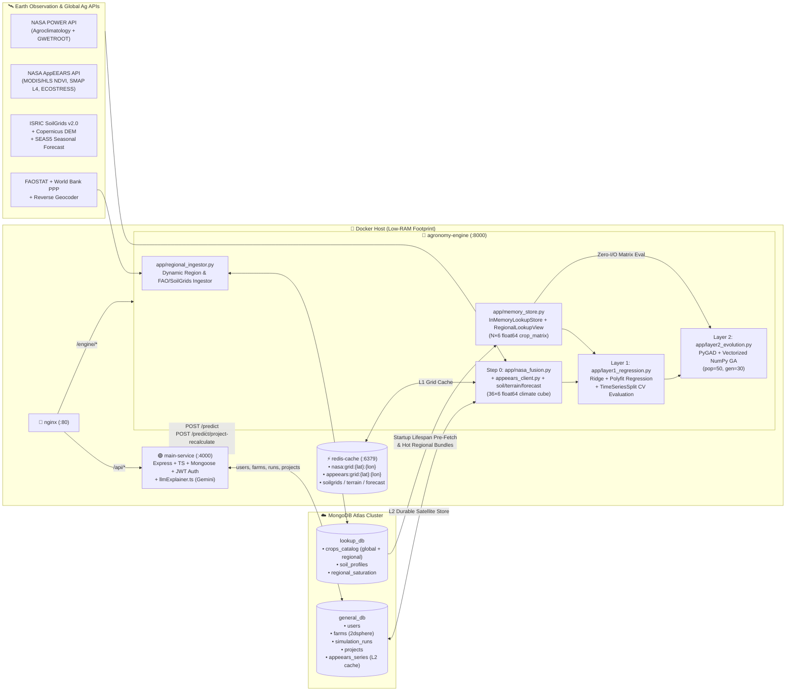

# 🌍 TerraShift — Field Shift: Adapting Farms with NASA Data

**2026 NASA Space Apps Challenge**

TerraShift is an end-to-end agronomy decision-support platform that helps farmers adapt to climate volatility and regional market shifts using **NASA POWER Agroclimatology (`T2M_MAX`, `T2M_MIN`, `RH2M`, `PRECTOTCORR`, `ALLSKY_SFC_SW_DWN`, `EVPTRNS`, `GWETROOT`, `GWETTOP`)**, **NASA AppEEARS Satellite Time Series (MODIS `MOD13Q1` & HLS `HLSS30` NDVI, SMAP L4 `SPL4SMGP` Root-Zone Soil Moisture, ECOSTRESS `ECO_L4T_ESI`)**, **ISRIC SoilGrids v2.0**, **Copernicus DEM Terrain Slope (`LS`)**, and **ECMWF SEAS5 Seasonal Forecasts**.

It combines a **MongoDB Atlas Dual-Database Architecture (`lookup_db` + `general_db`)** with an **In-Memory NumPy / PyGAD / Redis Processing Pipeline** that executes 36-month spatial-temporal regression and a multi-objective Genetic Algorithm in **under 15 ms** in RAM.

---

## 🏗️ System & Database Architecture



---

## 🧠 2-Layer In-Memory Agronomy Engine (`agronomy-engine/`)

1. **`seed_atlas.py` & `app/regional_ingestor.py` (Global Seed + Dynamic Regional Lookup Ingestor)**
   - Seeds `lookup_db.crops_catalog` (12 core crops: `paddy_rice`, `mung_bean`, `cowpea`, `maize`, `finger_millet`, `groundnut`, `sesame`, `chilli`, `onion`, `sunn_hemp`, `chickpea`, `cassava`), `lookup_db.soil_profiles`, and `lookup_db.regional_saturation`.
   - When a farmer draws a geofence anywhere in the world (`POST /regions/ensure` or during `POST /predict`), `regional_ingestor.py` reverse-geocodes the administrative region (`region_{iso2}_{subdivision}`), fetches **FAOSTAT** crop yields/prices and **World Bank PPP** conversion factors, enriches soil properties with **ISRIC SoilGrids v2.0**, persists the regional bundle to `lookup_db`, and hot-loads a `RegionalLookupView` NumPy matrix into RAM.
2. **`app/memory_store.py` (`InMemoryLookupStore` & `RegionalLookupView`)**
   - Pre-fetches `lookup_db` on FastAPI startup (`lifespan`) and packs a contiguous 2D `np.float64` matrix `crop_matrix` (`shape = N_crops × 6`: `[water_demand_mm, drought_tolerance, nitrogen_impact_kg_ha, erosion_cover_factor, input_cost_usd_ha, market_revenue_usd_ha]`).
   - Supports region-scoped views (`store.for_region(region_id)`) and deterministic local seed fallback so the container boots even if `ATLAS_MONGO_URI` is offline.
3. **`app/nasa_fusion.py` & `app/appeears_client.py` (Step 0: Multi-Source Spatial-Temporal Data Fusion)**
   - Fetches 36-month monthly **NASA POWER** agroclimatology (`T2M_MAX`, `T2M_MIN`, `RH2M`, `PRECTOTCORR`, `ALLSKY_SFC_SW_DWN`, `EVPTRNS`) and root-zone/top-layer soil wetness (`GWETROOT`, `GWETTOP`), cached in Redis at `nasa:grid:{lat:.2f}:{lon:.2f}` (`~1.1 km` grid cell, 24h TTL).
   - Non-blocking background prefetch (`app/appeears_client.py` + `app/appeears_store.py`) retrieves real 36-month **NASA AppEEARS** satellite series (**MODIS `MOD13Q1.061`** & **HLS `HLSS30_VI.020`** NDVI, **SMAP L4 `SPL4SMGP.008`** root-zone moisture percentile, and **ECOSTRESS `ECO_L4T_ESI.002`** evaporative stress) with L1 Redis caching and L2 MongoDB (`general_db.appeears_series`) persistence, plus support for offline AppEEARS CSV bundle imports.
   - Gathers **ISRIC SoilGrids v2.0** (`app/soil_client.py`), **Copernicus DEM** terrain slope & USLE `LS` factor (`app/terrain_client.py`), and **ECMWF SEAS5** 6-month seasonal forecasts (`app/forecast_client.py`) in parallel.
4. **`app/layer1_regression.py` (Layer 1: In-Memory Regression & Model Evaluation)**
   - Runs harmonic + linear time-feature `scikit-learn` `Ridge` regression and `numpy.polyfit` over the 36-month fused cube to project the next 18 months (3 × 6-month seasons) of precipitation, evapotranspiration, solar irradiance (`season_solar_kwh`), max temperature (`season_tmax_c`), and regressed SMAP root-zone soil moisture reserve.
   - Blends Season 1 projections with live seasonal forecast outlooks, computes Vapor Pressure Deficit (`mean_vpd_kpa`), frost months, planting-month soil moisture anomaly (%), NDVI-calibrated field vigor multiplier, and USLE bare-field erosion windows (`K × LS × NDVI`).
   - Logs out-of-sample model evaluation metrics (`evaluate_layer1_models`: 24-month train / 12-month test $R^2$, MAE, RMSE, Season 1 cumulative error %, and 3-fold `TimeSeriesSplit` cross-validation MAE).
5. **`app/layer2_evolution.py` (Layer 2: PyGAD + Vectorized NumPy Multi-Objective Genetic Algorithm)**
   - Evolves 3-season crop rotation chromosomes `[season1_crop_idx, season2_crop_idx, season3_crop_idx]` (`pop_size=50`, `n_gen=30`) using **PyGAD** backed by a vectorized NumPy batch fitness evaluator across Soil Health ($F_{\text{soil}}$), Water Resilience ($F_{\text{water}}$), and Farm Economics ($F_{\text{cost}}$).
   - Accounts for thermal stress, VPD, ECOSTRESS ESI, solar radiation bonuses, SoilGrids pH buffering, biological nitrogen fixation carryover (reducing synthetic urea spend), pest-family rotation breaks, and regional neighbor-farm oversupply penalties to generate:
     - `A_BASELINE` (current practice repeated across 3 seasons)
     - `B_SOIL_WATER_RESILIENCE` (soil regeneration & drought resilience)
     - `C_COST_MARKET_OPTIMIZED` (net margin, N-fixation savings & market diversity)
   - Exposes `POST /predict/project-recalculate` to evaluate custom 3-season user plans with per-season water and input cost overrides.

---

## 🖥️ Full-Stack Service & UI Capabilities

### 🟢 `main-service/` (Node.js + Express + TypeScript + Mongoose)
- **Authentication & Authorization (`/api/auth/*`)**: JWT registration, login, `/api/auth/me`, rate limiting, and Redis-backed token revocation (`/api/auth/logout`). All farms, simulation runs, and projects are strictly scoped to the authenticated farmer.
- **Geofence Farm Management (`/api/farms/*`)**: Stores GeoJSON `Polygon` boundaries (`2dsphere` indexed), computes area (ha) and centroid, triggers regional lookup ingestion (`/api/regions/ensure`) and non-blocking AppEEARS satellite prefetch (`/prefetch`), and cascades deletions across associated simulation runs and projects.
- **Simulation & AI Explainability (`/api/analyze`, `/api/analyses/*`)**: Orchestrates `agronomy-engine` predictions, generates farmer-friendly natural-language explanations via **Google Gemini (`gemini-2.5-flash`)** with deterministic fallback and Redis caching (`llmExplainer.ts`), and persists reports in `general_db.simulation_runs`.
- **Interactive 3-Season Projects (`/api/projects/*`)**: Snapshots any recommended strategy from a simulation report into an editable 3-season project plan and supports live recalculation (`POST /api/projects/:id/recalculate`) when farmers swap crops or adjust seasonal water/cost targets.

### 🌐 `frontend/` (Next.js 14 + Tailwind CSS + Leaflet)
- **`/login`**: Farmer authentication (Sign In / Create Account).
- **`/farm`**: Mobile-responsive interactive Leaflet satellite map with polygon drawing, dynamic region detection, satellite prefetch status indicator, soil/crop/priority configuration, and one-click simulation.
- **`/farms` & `/farms/[id]`**: Saved farm portfolio with report/project counts, boundary preview, and historical simulation runs.
- **`/results/[id]`**: Detailed simulation dashboard featuring risk breakdown cards, 36-month NASA climate & soil moisture charts, AI agronomic explanation, side-by-side strategy comparison (`A`, `B`, `C`), and **Create Project** modal.
- **`/projects` & `/projects/[id]`**: Interactive 3-season rotation planner with per-season crop selectors, water/cost override sliders, and instant agronomic/financial recalculation.

---

## 🔌 Key API Endpoints

| Service | Method & Path | Description |
| :--- | :--- | :--- |
| **main-service** | `POST /api/auth/register` \| `POST /api/auth/login` | Register or authenticate a farmer account (returns JWT) |
| **main-service** | `GET /api/auth/me` \| `POST /api/auth/logout` | Get current user profile or revoke active JWT |
| **main-service** | `GET /api/crops?region_id=...` | List global or region-specific crop catalog (cached 1h in Redis) |
| **main-service** | `POST /api/regions/ensure` | Resolve & ingest regional soil, crop economics, and saturation for `(lat, lon)` |
| **main-service** | `GET /api/farms` \| `POST /api/farms` | List or create/upsert authenticated farmer's geofenced farms |
| **main-service** | `GET /api/farms/:id` \| `PATCH /api/farms/:id` \| `DELETE /api/farms/:id` | Inspect, update, or delete a farm and its cascaded runs/projects |
| **main-service** | `POST /api/analyze` (alias `/api/analyses`, `/api/simulation-runs`) | Run full 2-layer agronomy simulation + Gemini explanation |
| **main-service** | `GET /api/analyses/:id/satellite-status` \| `POST /api/analyses/:id/refresh-satellite` | Check AppEEARS satellite status or re-run simulation with newly prefetched satellite data |
| **main-service** | `GET /api/projects` \| `POST /api/projects` | List projects or create a 3-season project from a simulation report |
| **main-service** | `POST /api/projects/:id/recalculate` | Recalculate a 3-season project with custom crops or water/cost overrides |
| **agronomy-engine** | `POST /predict` \| `POST /predict/project-recalculate` | Direct FastAPI endpoints for full GA optimization or fixed-plan recalculation |
| **agronomy-engine** | `POST /prefetch` \| `GET /prefetch/status` | Trigger or poll non-blocking NASA AppEEARS satellite prefetch |
| **agronomy-engine** | `POST /internal/reload-lookup` | Hot-reload `lookup_db` collections from MongoDB Atlas into RAM |

---

## 🚀 Quick Start (Local Development)

### 1. Configure Environment & Seed Atlas (Optional)
```bash
cp .env.example .env
# Set ATLAS_MONGO_URI, JWT_SECRET, and optional GEMINI_API_KEY / EARTHDATA_TOKEN in .env

# (Optional) Seed MongoDB Atlas lookup_db + general_db
cd agronomy-engine && python seed_atlas.py && cd ..
```

### 2. Start Backend Stack in Docker
Start `redis-cache`, `agronomy-engine`, `main-service`, and `nginx` (bound to `127.0.0.1:8080:80` by default):
```bash
docker compose up --build -d
curl http://localhost:8080/api/health
```

Authenticate and test a full simulation against the local gateway:
```bash
# 1. Register a local user and capture the JWT token
TOKEN=$(curl -s -X POST http://localhost:8080/api/auth/register \
  -H "Content-Type: application/json" \
  -d '{"name":"Demo Farmer","email":"farmer@example.com","password":"password123"}' \
  | python3 -c "import sys,json; print(json.load(sys.stdin)['token'])")

# 2. Run an inline geofence simulation
curl -X POST http://localhost:8080/api/analyze \
  -H "Content-Type: application/json" \
  -H "Authorization: Bearer $TOKEN" \
  -d '{
    "polygon": {
      "type": "Polygon",
      "coordinates": [[[80.38, 8.31], [80.42, 8.31], [80.42, 8.35], [80.38, 8.35], [80.38, 8.31]]]
    },
    "current_crop": "paddy_rice",
    "priority": "water"
  }'
```

### 3. Run Frontend Locally (`npm run dev`)
```bash
cd frontend
echo "NEXT_PUBLIC_API_BASE_URL=http://localhost:8080/api" > .env.local
npm install
npm run dev
```
Open **[http://localhost:3000/farm](http://localhost:3000/farm)** in your browser.

### 4. Run Tests
```bash
# Python Agronomy Engine unit & regression tests
cd agronomy-engine && pytest -q

# Main Service TypeScript tests
cd ../main-service && npm test
```

To stop all local containers:
```bash
docker compose down
```

---

## ☁️ Production Deployment (Ubuntu VPS + Vercel)

### 1. Backend on Ubuntu Server (Docker + HTTPS)
1. Clone the repo and configure `.env` (including `ATLAS_MONGO_URI`, `JWT_SECRET`, `GEMINI_API_KEY`, `EARTHDATA_TOKEN`, and your Vercel URL in `CORS_ORIGINS`):
   ```bash
   git clone <your-repo-url> /opt/TerraShift
   cd /opt/TerraShift
   cp .env.example .env
   # Set CORS_ORIGINS=https://your-app.vercel.app,http://localhost:3000
   ```
2. Start the backend containers (`nginx` binds `127.0.0.1:8080:80` so host Nginx can handle HTTPS):
   ```bash
   docker compose up --build -d
   ```
3. Enable HTTPS with Let's Encrypt (`Certbot`) using either a **zero-signup `sslip.io` domain** or your own domain/DuckDNS:
   ```bash
   PUBLIC_IP=$(curl -s4 ifconfig.me)
   sudo ./scripts/setup-https.sh "${PUBLIC_IP}.sslip.io"
   ```
   Verify over HTTPS:
   ```bash
   curl "https://${PUBLIC_IP}.sslip.io/api/health"
   ```

### 2. Frontend on Vercel (via GitHub Actions)
Auto-deployment is configured in [`.github/workflows/deploy-vercel.yml`](.github/workflows/deploy-vercel.yml) (works with both public and private GitHub Organization repos on Vercel's free Hobby plan):

1. Link `frontend/` once from your local machine and set the API URL:
   ```bash
   cd frontend
   npx vercel login
   npx vercel link
   printf "https://<YOUR-HTTPS-DOMAIN>/api" | npx vercel env add NEXT_PUBLIC_API_BASE_URL production
   ```
2. Add these 3 secrets in **GitHub Repo → Settings → Secrets and variables → Actions**:
   - `VERCEL_TOKEN` (from `vercel.com/account/tokens`)
   - `VERCEL_ORG_ID` (from `frontend/.vercel/project.json`)
   - `VERCEL_PROJECT_ID` (from `frontend/.vercel/project.json`)
3. Push to `main` (or trigger **Deploy Frontend to Vercel** manually in GitHub Actions).
4. Ensure your live Vercel URL is listed in `CORS_ORIGINS` in `/opt/TerraShift/.env` on Ubuntu, then run `docker compose up -d main-service`.

---

## 🌿 Team Git Workflow

See [`docs/branching-strategy.md`](docs/branching-strategy.md) for our 6-member GitHub Flow branching rules and PR checklist.
